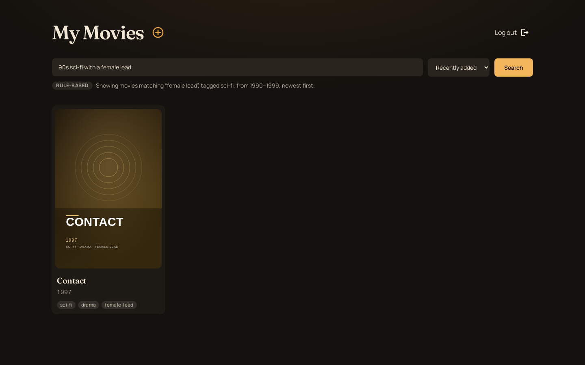
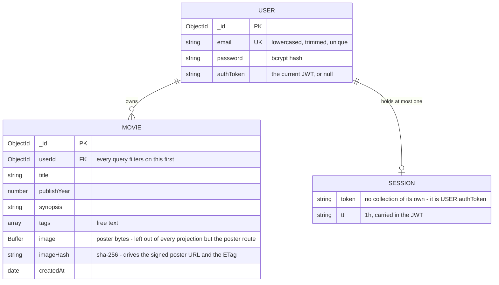
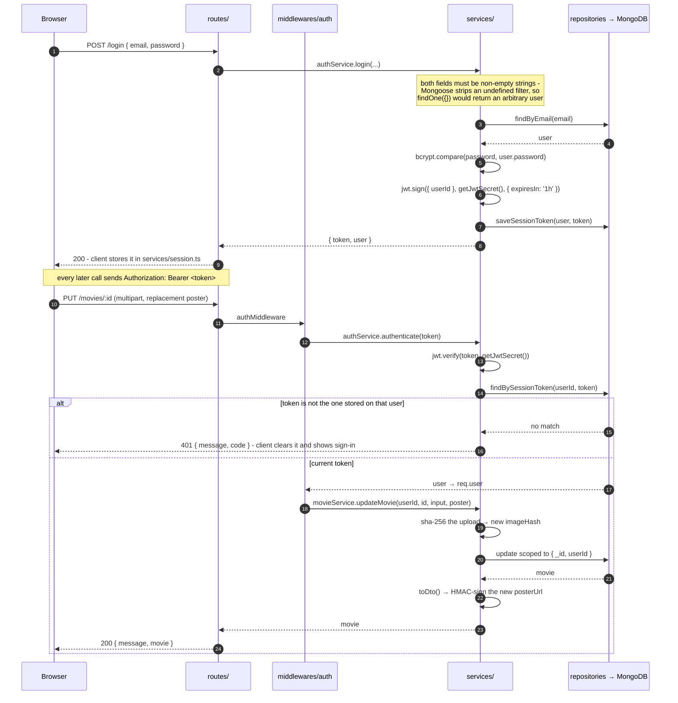
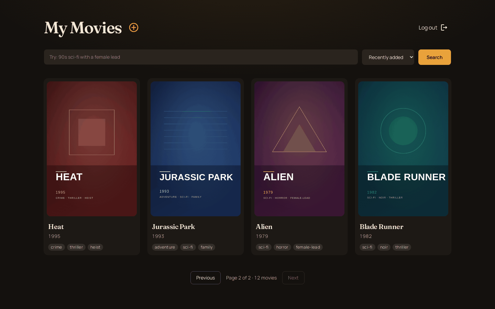
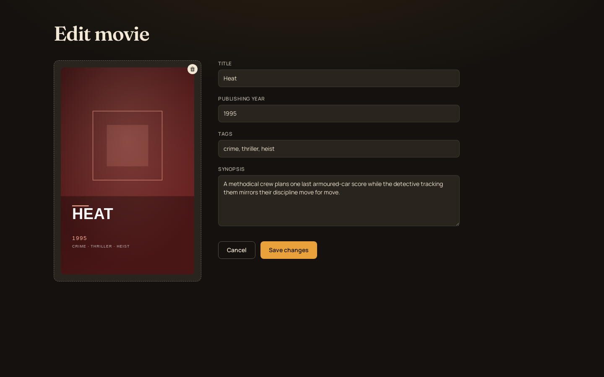

# Movies List

A personal film collection you sign into and curate: add a movie with a poster, a year, a
synopsis and tags, then find it again by typing what you half-remember rather than by
scrolling. Two packages share one typed HTTP contract: `movies-list-api` (Express +
TypeScript on MongoDB) and `movies-list-web` (Create React App + TypeScript + Tailwind).


Nothing in that grid is stock artwork. The seeder draws each poster as an SVG from the
title, year and tags (`movies-list-api/src/db/posterArt.ts`), so a fresh checkout has a
collection worth looking at without shipping image files.

## Finding a film you half-remember

The search box takes a sentence, not a keyword. "90s sci-fi with a female lead" becomes a
year range, a tag filter, a text term and a sort order, and the app shows you its reading
of the sentence before you trust the results:



That line under the search box (`RULE-BASED`, then *Showing movies matching "female
lead", tagged sci-fi, from 1990–1999, newest first*) is the planner's own output rendered
back to you (`describePlan` in `search/types.ts`). A search that misunderstands you says so.

Two planners implement the one `SearchPlanner` interface: a `name` and a
`plan(query: string): Promise<SearchPlan>`.

- `heuristicPlanner` is rule-based, dependency-free and always available: genre words and
  their common spellings, decade and year phrasings, and a stop-word list for the remainder.
- `anthropicPlanner` sends the sentence to Claude with a structured-output schema and
  **falls back to the heuristic planner on every failure path**: no key, network error,
  malformed output, or its 8-second timeout. Plans are cached per query for ten minutes.

A registry in `search/index.ts` picks one at startup, and `setSearchPlanner()` swaps in
another without the service layer knowing which is in play. No test makes a real API call;
the AI planner's tests inject a fake client.

## Getting it running

### With Docker (recommended)

You need Docker with Compose v2. One command builds both images, starts MongoDB, seeds a
demo collection with generated poster art, and starts the API and the web client:

```bash
JWT_SECRET=$(openssl rand -base64 48) docker compose up --build
```

If you would rather not pass the secret on the command line, `cp .env.example .env`, set
`JWT_SECRET` there, and run `docker compose up --build`. Compose reads `.env` on its own.

| Service | URL |
| --- | --- |
| Web client | <http://localhost:8290> |
| API | <http://localhost:8291> |
| API health | <http://localhost:8291/health> |

Sign in as **test@example.com** / **password123** (override with `SEED_EMAIL` and
`SEED_PASSWORD`). MongoDB is reachable only from the compose network and is not published
to the host. Setting `ANTHROPIC_API_KEY` switches search to the AI planner and changes
nothing else. Tear it down with `docker compose down -v`.

`JWT_SECRET` is written `${JWT_SECRET:?...}` in `docker-compose.yml`, so the stack refuses
to start without one rather than falling back to anything. The `seed` service runs once
and exits; the API waits for it, and the web container waits for the API's healthcheck.

### Without Docker

You need Node 22 (`.nvmrc`) and a MongoDB reachable at `MONGODB_URI`. If you have Docker
but want the dev servers, `docker run -d --name movies-mongo -p 27017:27017 mongo:7` is
enough.

```bash
npm ci --prefix movies-list-api
npm ci --prefix movies-list-web
npm ci                                                 # root, for concurrently

cp movies-list-api/.env.example movies-list-api/.env   # then set JWT_SECRET
npm run db:seed                                        # safe to re-run
npm start                                              # web :3000, API :3001
```

Scripts, all from the repository root:

| Command | What it does |
| --- | --- |
| `npm test` | 167 API tests (Jest + Supertest) and 84 web tests (React Testing Library). |
| `npm run lint` | ESLint over both packages; warnings fail it. |
| `npm run typecheck` | `tsc --noEmit` over both packages. |
| `npm run format:check` | Prettier over the API sources. |
| `npm run build` | API to `dist/`, web to `build/`. |
| `npm run db:seed` | Demo user, movies, poster art, and index sync. |
| `npm run contract:sync` | Re-copies `shared/contracts/api.ts` into both packages. |

## Talking to the API

These are real exchanges with the compose stack above. Tokens and signatures are
shortened.

```http
POST /login
Content-Type: application/json

{"email": "test@example.com", "password": "password123"}
```

```json
{
  "token": "eyJhbG…CgPE",
  "user": { "id": "6aef34c3a1ab4fe69cc62397", "email": "test@example.com" }
}
```

```http
GET /movies?q=90s%20sci-fi%20with%20a%20female%20lead&pageSize=8
Authorization: Bearer <token>
```

```json
{
  "movies": [
    {
      "id": "6aef34c3a1ab4fe69cc623a9",
      "title": "Contact",
      "publishYear": 1997,
      "synopsis": "A radio astronomer picks up a signal from Vega and fights the institutions around her for the right to answer it. A female lead carries the whole film.",
      "tags": ["sci-fi", "drama", "female-lead"],
      "posterUrl": "/movies/6aef34c3a1ab4fe69cc623a9/poster?v=539a5dd4e55f1de0&sig=ff6581…5806",
      "createdAt": "2026-11-07T14:25:07.500Z",
      "updatedAt": "2026-11-07T14:25:07.500Z"
    }
  ],
  "pagination": { "page": 1, "pageSize": 8, "total": 1, "totalPages": 1, "hasMore": false },
  "interpretation": {
    "source": "rules",
    "text": "female lead",
    "yearFrom": 1990,
    "yearTo": 1999,
    "tags": ["sci-fi"],
    "sort": "newest",
    "summary": "Showing movies matching “female lead”, tagged sci-fi, from 1990–1999, newest first."
  }
}
```

Fetching that `posterUrl` needs no header, and the response says how long it may be kept:

```http
HTTP/1.1 200 OK
Content-Type: image/svg+xml
Cache-Control: private, max-age=31536000, immutable
ETag: "539a5dd4e55f1de0"
X-Content-Type-Options: nosniff
Content-Security-Policy: default-src 'none'; style-src 'unsafe-inline'; sandbox
```

Every failure has the same shape. A truncated JSON body, for example:

```json
{ "message": "Request body could not be parsed", "code": "VALIDATION_FAILED" }
```

| Method | Path | Notes |
| --- | --- | --- |
| `POST` | `/login` | `{ email, password }` → `{ token, user }`. |
| `POST` | `/logout` | Bearer token; revokes that exact session. |
| `GET` | `/health` | `200` with uptime, database and AI-search status; `503` when MongoDB is disconnected. |
| `GET` | `/movies` | `page`, `pageSize`, `q`, `sort`. Returns movies, pagination and the search interpretation. |
| `POST` | `/movies` | `multipart/form-data`; a poster in the `image` field is required. |
| `GET` | `/movies/:id` | Single movie. |
| `PUT` | `/movies/:id` | `multipart/form-data`; the poster is replaced only if one is sent. |
| `DELETE` | `/movies/:id` | Removes the movie. |
| `GET` | `/movies/:id/poster` | Poster bytes, by signed URL or bearer token; `304` on a matching `ETag`. |

A Postman collection with saved examples lives in
[`postman/`](postman/Movie-List.postman_collection.json).

## The data, and why it is shaped this way



`SESSION` is drawn separately to make the rule visible, but it is not a collection: the
token is one field on the user document, which is why a second sign-in ends the first.

Every list query filters by `userId` and then sorts, so `models/movie.ts` declares compound
indexes on `{userId, createdAt}`, `{userId, publishYear}`, `{userId, title}` and
`{userId, tags}`, plus a weighted text index over title, synopsis and tags (a title hit
outranks a synopsis hit 10:1). Without them MongoDB collection-scans and sorts in memory,
which stops working outright past 32 MB of matching documents. `index.ts` calls
`syncIndexes()` on boot, so a fresh database gets them.

Dependencies point inward, one direction only: `routes/` are thin HTTP adapters,
`services/` hold the use cases, `repositories/` are the only modules that touch Mongoose,
and `models/` own the schemas. Keeping Mongoose in the repositories also keeps its quirks
there. `.lean()` returns poster bytes as a BSON `Binary`, not a `Buffer`, and
`findPoster` converts it before the service sees it.

## What a token is allowed to do



Three properties of that flow are deliberate and worth not regressing:

- **The signing secret comes from the environment and has no default.** `getJwtSecret()`
  (in `config/env.ts`) throws when `JWT_SECRET` is unset, and `startServer()` calls it
  before it connects to anything, so a missing secret stops the process at boot instead of
  surfacing later as a broken login.
- **A stale token cannot log anyone out.** `logout` checks that the presented token is the
  one currently stored on the user before clearing it.
- **Ownership is enforced in the query, not after it.** Repository reads and writes are
  scoped to `userId`, so a guessed movie id returns `404`, not someone else's film.

On the client, any `401` (an expired hour, or a sign-in on another device) clears the
stored token and returns to the sign-in screen instead of offering a retry that cannot
succeed.

## Keeping the list cheap

`GET /movies` is the endpoint everything else hangs off, and the first to get expensive.

**Pagination and projection.** `page` and `pageSize` (default 12, capped at 100; the web
client asks for 8) with a `MOVIE_PROJECTION` that leaves poster bytes out of every query
except the poster route itself.



**Posters as capability URLs.** An `` tag cannot send an `Authorization` header, so
each poster gets a signed URL rather than a widened route: an HMAC over
(owner, movie, content hash), derived from `JWT_SECRET` through a labelled sub-key. The
content hash sits in both the signature and the query string, so that URL is served
`immutable` for a year and replacing a poster invalidates it for free. A bare
`/movies/:id/poster` fetched with a bearer token keeps its URL across replacements, so it
is served `no-cache` and revalidates against the `ETag` instead. Poster responses also
carry `nosniff` and a `default-src 'none'; sandbox` CSP, because the generated art is SVG
and SVG can carry script. Uploads are limited to JPEG, PNG, WebP and GIF.

**A bounded read-through cache.** List pages are cached by user, plan and page for
`LIST_CACHE_TTL_MS`; every write drops that user's pages by key prefix. The store is capped
at 500 entries with LRU eviction and sits behind the `CacheStore` interface so Redis can
replace it.

**Code-split routes.** `Router.tsx` loads all four pages through `React.lazy`, keeping the
form stack out of the chunk that renders the list. `npm run build` emits a 143,998 B entry
bundle (46,557 B gzipped) plus eight lazy chunks, 349,608 B raw in total. Formik and Yup
share one 76,315 B chunk and the dropzone has a 61,443 B one, and neither is fetched until
you open a form.

## The client

The look is a darkened auditorium: warm near-black, programme-paper text, and a
marquee-bulb amber reserved for the one action on each screen. Headings are set in
Fraunces and body text in Manrope; the tokens live in `tailwind.config.js`.

The edit screen exercises most of the API at once: a `GET /movies/:id`, a poster fetched
from its signed URL, then a `PUT` that replaces the image only if you dropped a new one.



Every field has a visible label, and validation messages are tied to their input with
`aria-describedby`. The list has loading, empty, no-results and error states. On a phone
the layout drops to one column and the delete control stays visible, since there is no
hover to reveal it:

<p>
  
  
</p>

## Environment

`movies-list-api` reads everything through `src/config/env.ts`, lazily, so values arrive
after `dotenv.config()` whatever the import order. Copy `movies-list-api/.env.example` to
`.env` for local runs; compose sets these itself.

| Variable | Required | Default | Purpose |
| --- | --- | --- | --- |
| `JWT_SECRET` | **yes** | _none, throws_ | Signs and verifies JWTs, and derives the poster URL signing key. `openssl rand -base64 48`. |
| `MONGODB_URI` | **yes** | _none, throws_ | Connection string, without the database name. |
| `MONGODB_DB` | no | `movie-list` | Database name appended to `MONGODB_URI`. |
| `PORT` | no | `3001` | Port the API listens on. |
| `CORS_ORIGINS` | no | `*` | Comma-separated allowed origins. Compose pins it to the web client; pin it in any real deployment. |
| `MAX_UPLOAD_BYTES` | no | `5242880` | Largest poster upload accepted (5 MB). |
| `LIST_CACHE_TTL_MS` | no | `30000` | How long a list page stays cached. |
| `ANTHROPIC_API_KEY` | no | _unset_ | Enables AI-assisted search. Unset means the rule-based planner. |
| `ANTHROPIC_MODEL` | no | `claude-opus-5` | Model used for search planning. |
| `SEED_EMAIL` / `SEED_PASSWORD` | no | `test@example.com` / `password123` | Demo account created by `npm run db:seed`. |

`movies-list-web` has one variable, and Create React App inlines it at **build** time:
`REACT_APP_SERVER_URL` (default `http://localhost:3001`) is the API's address as the
*browser* reaches it. Compose bakes in `http://localhost:8291`, or `PUBLIC_API_URL` if set.

## Where things live

```
shared/contracts/api.ts     SOURCE OF TRUTH for the HTTP contract
scripts/sync-contracts.js   copies it into both packages

movies-list-api/src/
  index.ts                  boot: read the secret, connect, sync indexes, listen
  config/env.ts             every env var, read lazily; required ones throw
  routes/ middlewares/      HTTP adapters; auth, asyncRoute, errorHandler
  services/                 use cases - the layer to read first
    movieService.ts / authService.ts / posterUrl.ts / cache.ts
  search/                   the SearchPlanner seam: types, heuristic, anthropic, registry
  repositories/             the ONLY Mongoose access in the codebase
  models/ db/               schemas and indexes; connection, seeder, poster art

movies-list-web/src/
  services/api.ts           the only module that speaks HTTP
  services/session.ts       the only module that knows where the token lives
  pages/ components/ routes/Router.tsx    screens, widgets, lazily-loaded routes
```

Create React App refuses to compile imports from outside `src/`, which is why the contract
is copied rather than imported. A test in each package
(`movies-list-api/src/__tests__/contract.test.ts`, `movies-list-web/src/contracts/contract.test.ts`)
fails if its copy drifts from `shared/contracts/api.ts`.

## Known gaps

- **One session per user, and no sign-up flow.** The token lives on the user document, so a
  second sign-in ends the first; accounts come from the seeder.
- **Posters live in MongoDB.** Fine at this scale and it keeps the stack to one datastore,
  but object storage behind a CDN is the answer past a few thousand images, a move the
  capability-URL scheme confines to `posterUrl.ts` and the poster route.
- **The cache is per-process.** Two API containers keep two caches, so a write on one is
  invisible to the other for up to `LIST_CACHE_TTL_MS`.
- **Search is single-language and literal.** The rule-based planner knows a fixed list of
  genre words and date phrasings, the AI planner reads prose far better but needs a key,
  and neither does semantic similarity over synopses.
- **No refresh tokens and no rate limiting.** Tokens last an hour, and login is not
  throttled.
- **Tags are free text**, so `sci-fi` and `scifi` are two tags if you type both.
- **Create React App is unmaintained.** `react-scripts` 5 pins TypeScript 4.9 and its
  build toolchain accounts for every remaining `npm audit` finding in the web package;
  moving to Vite is the next structural step. Express 5 and Mongoose 9 are also not adopted
  yet.

## License

MIT; see [LICENSE](LICENSE).
